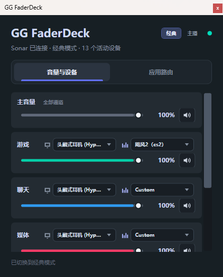
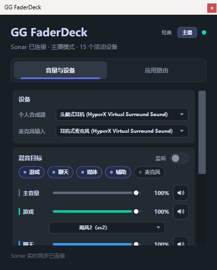
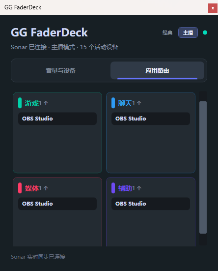

# GG FaderDeck

Windows 托盘混音面板，为 SteelSeries GG / Sonar 提供更快的通道音量、设备绑定、EQ 与应用路由操作。

> **非官方项目。** 本项目由第三方开发，与 SteelSeries 没有任何关联，未获其授权或背书。
> 程序只调用 GG / Sonar 在本机 loopback 上暴露的 HTTP 接口，不包含、不修改、不重新分发其任何代码或资源。
> "SteelSeries"、"Sonar"、"GG" 等名称与商标归其各自所有者。详见 [免责声明](docs/notice.md)。

> 名称中的 "GG" 仅用于说明本工具配合 SteelSeries GG 使用，不表示任何官方关系。

## 功能

**经典模式**（对应 Sonar 的 classic 混音）

- 主音量、游戏、聊天、媒体、辅助、麦克风 六条通道的音量、静音、输出/输入设备绑定
- 快速切换 EQ 预设：收藏优先，其余滚动加载并可搜索
- 主音量拖动时其余通道按比例跟随，与 Sonar 服务端语义一致

**主播模式**（对应 Sonar 的 Streamer mode）

- 右上角一键切换经典 / 主播，切换即写入 `/mode`
- 直播混音（streaming）与监听混音（monitoring）两套音量与静音，互不覆盖
- 用胶囊开关选择哪些通道进入当前混音
- 「个人合成器」「麦克风输入」两个重定向设备的快捷切换（下拉只列物理设备，隐藏 Sonar 虚拟声卡）
- 「监听」开关决定当前调节的是个人合成器还是流式处理器

**应用路由**

- 按 游戏 / 聊天 / 媒体 / 辅助 四张声卡卡片列出当前连接的应用
- 把应用拖到另一张卡片即可切换该进程的输出，OBS 这类多会话应用不会被错误折叠

**实时同步**

- 通过 Sonar 的 WebSocket 事件同步音量；键盘媒体键或 GG 内的改动会自动反映到面板
- 调整音量时通过 Windows 虚拟端点写入，让 GG 也能及时跟随
- 连接异常自动重连，并降级为低频 HTTP 轮询

## 截图

经典模式：



主播模式：



应用路由：



## 系统要求

- Windows 10 / 11 x64
- 已安装并启动 SteelSeries GG，Sonar 已启用
- thin 版需要 .NET 8 Desktop Runtime；standalone 版自带运行时

## 下载

从 [Releases](../../releases) 下载，两种形态功能完全一致：

| 文件 | 体积 | 常驻内存（实测） | 说明 |
| --- | --- | --- | --- |
| `FaderDeck-1.0.0-win-x64.exe` | 约 0.86 MB | 约 131 MB 工作集 / 64 MB 私有 | 单文件，需本机已装 .NET 8 Desktop Runtime（推荐） |
| `FaderDeck-1.0.0-win-x64-standalone.exe` | 约 63 MB | 约 245 MB 工作集 / 130 MB 私有 | 单文件自包含，不需要运行时 |

自包含版内存更高，是因为整套 .NET + WPF 程序集被打进同一个 bundle，运行时必须常驻内存；thin 版由已安装的运行时按需加载。两者功能一致。

standalone 版首次运行会把 WPF 原生库解压到 `%TEMP%\.net\<应用名>\<哈希>`。若该路径不可写（TEMP 被组策略重定向、磁盘已满等），宿主会直接退出，退出码 `-2147450720` / `-2147450721`。此时可改用 thin 版，或显式指定解压目录：

```text
set DOTNET_BUNDLE_EXTRACT_BASE_DIR=D:\some-writable-dir
FaderDeck-1.0.0-win-x64-standalone.exe
```

## 从源码构建

```powershell
dotnet build FaderDeck.sln
dotnet run --project tests/FaderDeck.Tests        # 单元测试
dotnet run --project src/FaderDeck.Probe          # 打印当前 Sonar 状态
dotnet run --project src/FaderDeck.App            # 启动面板
```

发布单文件：

```powershell
# thin：需要目标机安装 .NET 8 Desktop Runtime
dotnet publish src/FaderDeck.App -p:PublishProfile=win-x64

# self-contained：不需要运行时
dotnet publish src/FaderDeck.App -p:PublishProfile=win-x64-standalone
```

仓库的 `NuGet.Config` 清空了包源，自包含发布首次需要联网还原运行时包，可加
`-p:RestoreSources="https://api.nuget.org/v3/index.json"`。

探针的写接口回环验证（不会改变现有配置）：

```powershell
dotnet run --project src/FaderDeck.Probe -- --verify-current-writes
dotnet run --project src/FaderDeck.Probe -- --verify-streamer-writes
```

## 支持范围

- 开发与实测环境：**SteelSeries GG 116.x / Sonar 1.104**（Windows 11 x64）
- 依赖的都是 Sonar 的内部 HTTP 接口，GG 升级后可能变化。若某次更新后功能异常，运行探针可以看清是哪一步失败：

```powershell
dotnet run --project src/FaderDeck.Probe -- --verify-current-writes
```

- 版本变化见 [CHANGELOG](CHANGELOG.md)。

## 反馈

- 发现 bug 或有功能建议，欢迎开 issue，请附上 GG 版本、面板截图与探针输出。
- 面板文案为中文；如需其它语言，翻译集中在 `MainWindow.xaml.cs` 的 `ChannelNames` 与各 `Text=` 字符串。
## 已知限制

- **GG 只在启动时读取一次 `/mode`**：在 FaderDeck 里切换经典 / 主播后，GG 已打开的页面不会自动重绘。
  把 GG 窗口关到托盘再打开（或重启 GG）即可让它重新读取。
- **EQ 显示同理**：切换生效但 GG 的 EQ 下拉可能仍显示旧预设，重新打开 GG 页面后一致。
- **Sonar 端口每次启动都会变化**：程序通过 TCP 监听表 + `/mode` 探测自动发现，不需要手动配置。
- **部分操作只在对应模式下有效**：Sonar 在经典模式下会拒绝主播混音的写入（返回
  `Cannot be called in current mode`），FaderDeck 会自动纠正模式后重试。
- 托盘图标依赖 `Shell_NotifyIcon`。若资源管理器以管理员身份运行，普通权限进程会被 UIPI 拒绝注册，
  表现为「进程在跑但托盘没有图标」；此时以相同权限运行 FaderDeck 即可。

## 图标

`Assets/faderdeck.ico` 由 `Assets/app-icon.png` 生成（八种尺寸）。替换图标时把新的方形原图交给脚本即可，它会自动抠掉浅色背景、圆角化并按尺寸重绘：

```powershell
powershell -ExecutionPolicy Bypass -File tools/Import-AppIcon.ps1 `
  -SourcePath .\path\to\square-artwork.png `
  -OutputPath .\src\FaderDeck.App\Assets\faderdeck.ico `
  -PreviewPath .\src\FaderDeck.App\Assets\app-icon.png
```

16/20/24 像素帧由脚本用矢量重绘，直接缩小原图会糊成一团；托盘图标读取的就是这个 ico。

## 目录结构

```
src/FaderDeck.App          WPF 托盘面板
src/FaderDeck.Application  状态服务与写入调度
src/FaderDeck.Domain       领域模型
src/FaderDeck.Sonar        Sonar 发现、HTTP 客户端、事件客户端
src/FaderDeck.Probe        命令行探针
tests/FaderDeck.Tests      无依赖的测试运行器
docs/                      接口观测、发布说明、截图、免责声明
```

## 免责声明

使用前请阅读 [docs/notice.md](docs/notice.md)。摘要：

- 非官方项目，与 SteelSeries 无关联、无授权、无背书
- 不含厂商代码或资源；只调用其在本机 loopback 上暴露的接口
- 按「现状」提供，不附带任何担保；使用风险由使用者自行承担
- 商标与产品名称归其各自所有者

## 许可证

[MIT](LICENSE)
